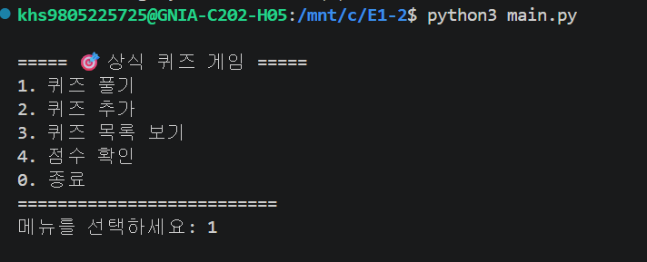
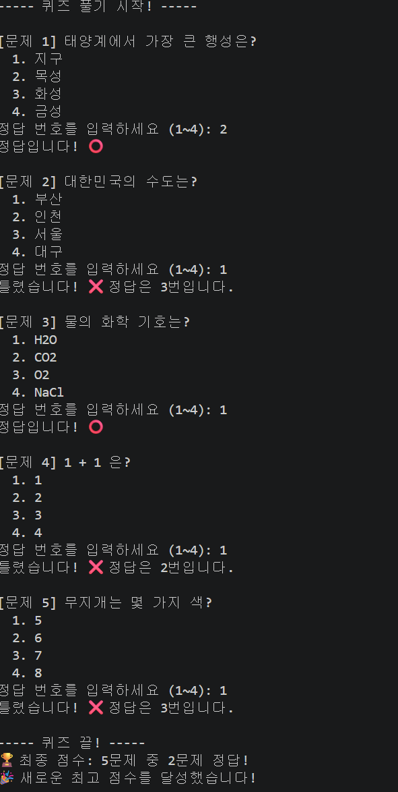
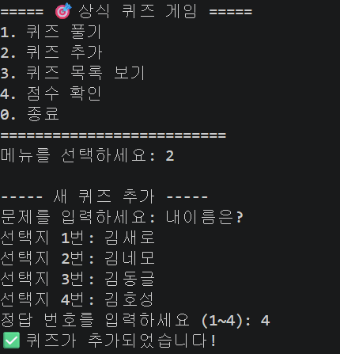
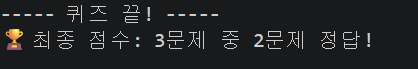
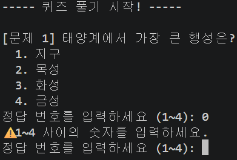
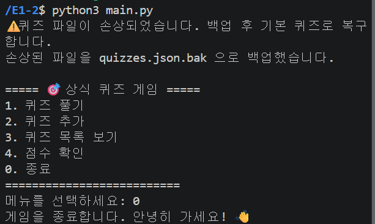
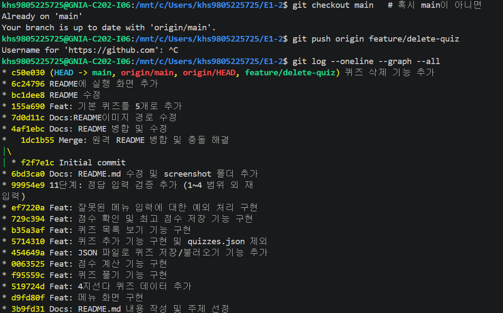

p
# 🎯 나만의 퀴즈 게임

터미널에서 동작하는 Python 퀴즈 게임입니다. 

<!-- TODO: 한두 문장으로 이 프로젝트가 무엇인지 적기 -->

## 1. 프로젝트 개요

파이썬으로 만든 콘솔 기반 퀴즈 게임입니다.
퀴즈 풀기, 추가, 목록 확인, 점수 확인 기능을 제공하며
데이터는 state.json에 저장되어 재실행 후에도 유지됩니다.

## 2. 퀴즈 주제와 선정 이유

- **주제**: 상식 퀴즈
- **선정 이유**: 파이썬 기초습득이 목적이었기 때문에 누구나 알 수 있는 상식퀴즈로 준비했습니다.

## 3. 실행 방법

**요구 사항**
- Python 3.10 이상
- 외부 라이브러리 없음 (표준 라이브러리만 사용)

**실행**
```bash
git clone https://github.com/아이디/E1-2.git
cd E1-2
python main.py
```

## 4. 기능 목록

| 기능 | 설명 |
|---|---|
| 퀴즈 풀기 | 저장된 퀴즈를 출제하고 정답 여부와 결과를 보여줍니다. |
| 퀴즈 추가 | 문제, 선택지 4개, 정답 번호를 입력해 새 퀴즈를 등록합니다. |
| 퀴즈 목록 | 등록된 퀴즈를 확인합니다. |
| 점수 확인 | 최고 점수를 확인하고, 퀴즈를 풀 때마다 갱신합니다. |
| 데이터 저장 | 종료 후에도 퀴즈와 최고 점수가 유지됩니다. |
| 입력/예외 처리 | 잘못된 입력, Ctrl+C, 파일 손상 등을 안전하게 처리합니다. |

<!-- 보너스 과제를 하면 여기에 추가 -->

## 5. 파일 구조

```
E1-2/
├── main.py
├── state.json
├── README.md
├── .gitignore
└── docs/
    └── screenshots/
```

<!-- 실제 파일이 늘어나면 함께 수정 -->

## 6. 데이터 파일 설명 (state.json)

- **경로**: 프로젝트 루트의 `state.json`
- **역할**: 퀴즈 목록과 최고 점수를 저장해 프로그램을 다시 실행해도 유지합니다.
- **인코딩**: UTF-8
- **스키마**

```json
{
    "quizzes": [
        {
            "question": "문제",
            "choices": ["선택지1", "선택지2", "선택지3", "선택지4"],
            "answer": 1
        }
    ],
    "best_score": 0
}
```

| 필드 | 타입 | 설명 |
|---|---|---|
| quizzes | list | 퀴즈 목록 |
| question | str | 문제 |
| choices | list | 선택지 4개 |
| answer | int | 정답 번호 (1~4) |
| best_score | int | 최고 점수 |

- **파일이 없을 때**: quizzes.json이 없으면 코드에 내장된 기본 퀴즈 5개(default_quizzes)를
자동으로 불러와 게임을 시작합니다.
score.json이 없으면 최고 점수를 0점으로 초기화합니다.
- **파일이 손상됐을 때**: quizzes.json 내용이 잘못된 경우 json.load()에서 오류가 발생하며,
기본 퀴즈(default_quizzes)로 대체됩니다.

## 7. 실행 화면

| 메뉴 | 퀴즈 풀기 |
|---|---|
|  |  |

| 퀴즈 추가 | 점수 확인 |
|---|---|
|  |  |

| 다른 명령어 입력시 | 파일 손상시 |
|---|---|
|  |  |

## 8. 개발 기록

### Git 작업 기록

| 단계 | 사용한 명령어 | 배운 점 |
|---|---|---|
| 저장소 설정 | init, add, commit, push | 파일을 버전별로 관리하는 방법을 배웠습니다. |
| 퀴즈 풀기 (브랜치) | checkout, merge | 기능별로 브랜치를 나눠 개발하는 방법을 배웠습니다. |
| 저장소 복제 실습 | clone, pull | 원격 저장소를 로컬로 가져오는 방법을 배웠습니다. |

## 9. 🌿 브랜치 전략

이 프로젝트는 기능별로 브랜치를 나누어 개발했습니다.

- `main` : 최종 완성 버전
- 별도 브랜치에서 README 작성 및 삭제 기능 개발 진행
- 작업 완료 후 main 브랜치로 merge
- merge 과정에서 발생한 충돌을 직접 해결

### 커밋 그래프


위 그래프에서 브랜치가 분기되었다가 `Merge` 커밋으로
합쳐지는 과정을 확인할 수 있습니다.

### 막혔던 점과 해결 방법

- quizzes.json 파일을 저장할 때 한글이 깨지는 문제가 있었습니다.
  → json.dump()에 ensure_ascii=False, encoding="utf-8" 옵션을 추가해 해결했습니다.
 

### 배운 점

- 클래스(Quiz, QuizGame)를 나눠 역할을 분리하면 코드가 읽기 쉬워진다는 것을 배웠습니다.
- JSON 파일로 데이터를 저장하고 불러오는 방법을 익혔습니다.
- Git 브랜치를 활용해 기능별로 개발하고 병합하는 흐름을 경험했습니다. 

# E1-2
파이썬으로 퀴즈생성 및 git 브랜치 생성 및 병합 작업