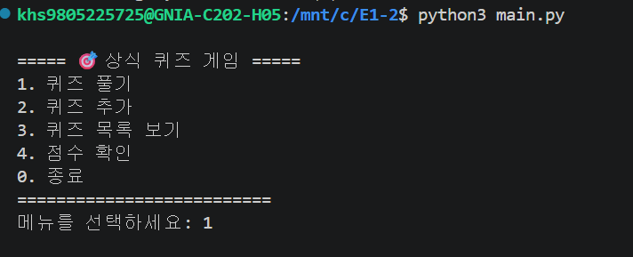
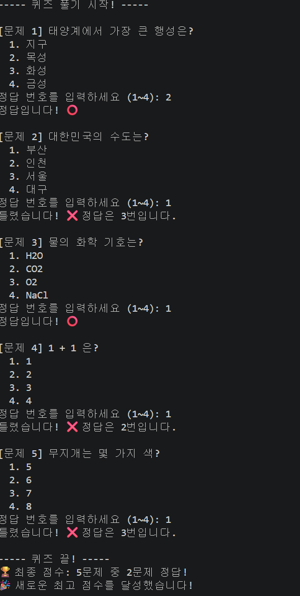
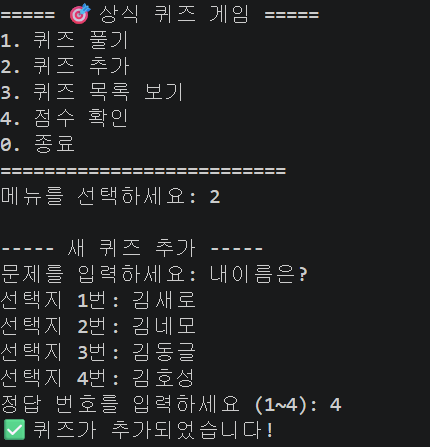
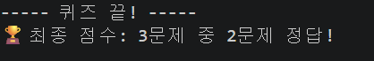
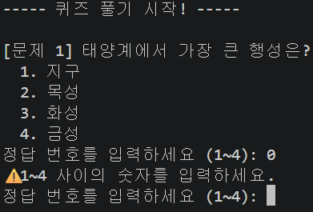
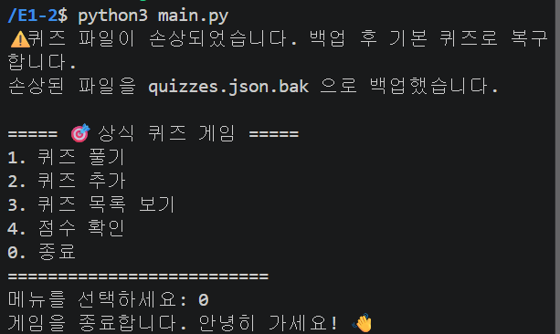
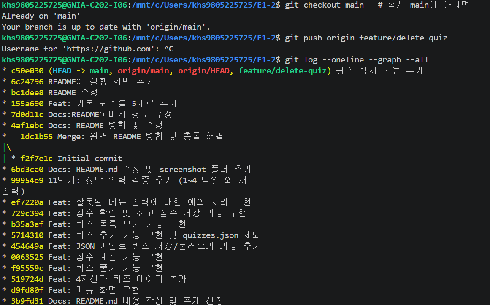
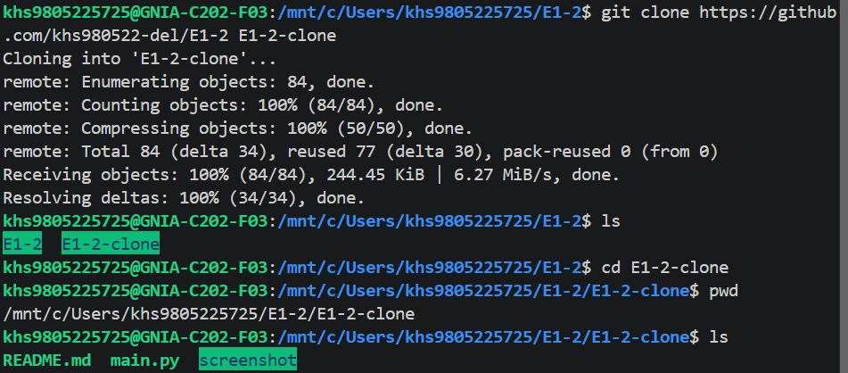
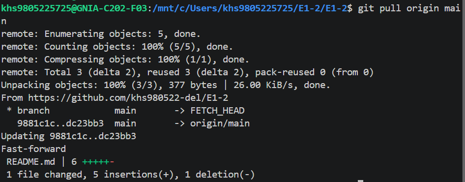

# 🎯 나만의 퀴즈 게임

터미널에서 동작하는 Python 콘솔 기반 퀴즈 게임입니다. 객체지향 설계(`Quiz`, `QuizGame`)와 JSON 기반 데이터 영속성을 적용하여 유지보수성과 안정성을 높였습니다.

## 1. 프로젝트 개요

파이썬으로 만든 콘솔 기반 퀴즈 게임입니다.
퀴즈 풀기, 추가, 목록 확인, 점수 확인 및 삭제 기능을 제공하며, 데이터는 `state.json`에 저장되어 재실행 후에도 유지됩니다.

## 2. 퀴즈 주제와 선정 이유

- **주제**: 상식 퀴즈
- **선정 이유**: 파이썬 기초 습득 및 객체지향 프로그래밍(OOP) 구조 학습이 목적이었기 때문에, 누구나 쉽게 이해하고 테스트할 수 있는 상식 퀴즈로 준비했습니다.

## 3. 실행 방법

**요구 사항**
- Python 3.10 이상
- 외부 라이브러리 없음 (표준 라이브러리만 사용)

**실행**
```bash
git clone https://github.com/아이디/E1-2.git
cd E1-2
python main.py
```

**기본 퀴즈 개수 변경 방법**
- `main.py` 코드 내 `default_quizzes` 리스트에 퀴즈 항목을 추가하거나 삭제하여 초기 기본 퀴즈 개수를 간편하게 변경할 수 있습니다.

**실행 및 메뉴 동작 흐름 예시**
1. 프로그램 실행(`python main.py`) 시 `load_quizzes()`가 호출되어 기존 데이터(`state.json`)를 자동으로 불러옵니다.
2. 메인 메뉴에서 원하는 기능 번호를 입력합니다:
   - `1`: 퀴즈 풀기 (순차 출제 후 정답 판정 및 최고점 갱신)
   - `2`: 퀴즈 추가 (질문, 선택지 4개, 정답 번호 입력 후 저장)
   - `3`: 퀴즈 목록 확인 (등록된 전체 퀴즈 출력)
   - `4`: 점수 확인 (현재까지 기록된 최고 점수 조회)
   - `5`: 퀴즈 삭제 (선택한 번호의 퀴즈 삭제 후 저장)
   - `0`: 게임 종료 (최신 데이터 저장 후 안전 종료)

## 4. 기능 목록 및 클래스/메서드 설계

| 기능 | 설명 |
|---|---|
| 퀴즈 풀기 | 저장된 퀴즈를 출제하고 정답 여부와 결과를 보여줍니다. |
| 퀴즈 추가 | 문제, 선택지 4개, 정답 번호를 입력해 새 퀴즈를 등록합니다. |
| 퀴즈 목록 | 등록된 퀴즈를 확인합니다. |
| 점수 확인 | 최고 점수를 확인하고, 퀴즈를 풀 때마다 갱신합니다. |
| 데이터 저장 | 종료 후에도 퀴즈와 최고 점수가 유지됩니다. |
| 입력/예외 처리 | 잘못된 입력, Ctrl+C, 파일 손상 등을 안전하게 처리합니다. |
| 퀴즈 삭제 | 기존 퀴즈나 생성한 퀴즈를 삭제합니다. |

### 📐 클래스 구조 및 메서드별 책임
| 클래스 | 핵심 메서드 | 역할 및 한 줄 설명 |
|---|---|---|
| `Quiz` | `__init__()`, `is_correct()` | 개별 퀴즈 1개의 데이터(문제, 선택지, 정답)를 캡슐화하고 사용자의 입력이 정답인지 판별합니다. |
| `QuizGame` | `run()` | 메인 메뉴 출력, 사용자 선택 분기 및 전체 게임 실행 루프를 제어합니다. |
| `QuizGame` | `play_quiz()`, `add_quiz()`, `delete_quiz()` | 퀴즈 진행, 신규 등록, 삭제 기능 수행 및 사용자 입력값의 유효성을 검증합니다. |
| `QuizGame` | `load_quizzes()`, `save_quizzes()`, `save_high_score()` | JSON 파일 입출력, 최고점 동기화, 손상 파일 백업(`_backup_corrupted_file`)을 담당합니다. |

### 💡 클래스 분리 근거 (추상화·재사용성 및 관심사 분리)
- **추상화 및 재사용성 관점**: `Quiz` 클래스를 통해 개별 퀴즈의 속성과 정답 판정 로직을 하나의 독립된 객체로 추상화했습니다. 덕분에 향후 콘솔 환경에서 웹(Web)이나 GUI 환경으로 확장하더라도 `Quiz` 모델 클래스는 수정 없이 그대로 재사용할 수 있습니다.
- **영역별 관심사 분리 (입력검증 · 게임진행 · 데이터입출력)**:
  1. **입력검증 영역**: 잘못된 메뉴 번호나 범위 외 정답 입력을 걸러내어 게임 로직이 오염되는 것을 방지합니다.
  2. **게임진행 영역**: 퀴즈 출제와 점수 계산 흐름에만 집중하여 전체 제어 로직의 가독성을 높였습니다.
  3. **데이터입출력 영역**: 파일 저장/로드 및 예외 복구 코드를 별도 메서드로 분리하여, 추후 저장소를 JSON에서 데이터베이스(DB)로 교체할 때 입출력 메서드만 수정하면 되도록 설계했습니다.

## 5. 파일 구조

```
E1-2/
├── main.py
├── state.json
├── README.md
├── .gitignore
├── screenshot/
│   ├── menu.png
│   ├── play.png
│   ├── add_quiz.png
│   ├── score.png
│   ├── exeptsituation.png
│   ├── break.png
│   ├── branch_graph.png
│   ├── makeclone.png
│   └── gitclone.png
└── docs/
    └── screenshots/
```

## 6. 데이터 파일 설명 (`state.json`) 및 예외 복구 정책

- **경로**: 프로젝트 루트의 `state.json`
- **선택 이유**: JSON 포맷은 사람이 직접 읽고 수정하기 쉬운 뛰어난 **가독성**을 갖추고 있으며, 계층적인 **구조화**된 데이터를 파이썬 표준 `json` 모듈로 직관적으로 직렬화/역직렬화할 수 있어 선택했습니다.
- **인코딩**: UTF-8
- **데이터 로드 및 저장 시점 순서 (전체 흐름)**:
  1. **초기화 및 로드 (`__init__` → `load_quizzes`)**: 프로그램 시작 시 `state.json`에서 기존 퀴즈와 최고 점수를 메모리에 적재합니다.
  2. **게임 진행 중 상태 갱신**: 퀴즈 추가/삭제 또는 게임 완료 시 메모리 상의 리스트(`self.quizzes`)와 점수를 갱신하고 즉시 디스크에 반영합니다.
  3. **종료 시 동기화 (정상 종료 및 `KeyboardInterrupt`)**: 사용자가 종료 메뉴를 선택하거나 `Ctrl+C`로 강제 종료할 때도 종료 핸들러에서 `save_quizzes()` 및 `save_high_score()`를 호출하여 모든 변경 사항과 최고점 저장을 보장합니다.

### 스키마
```json
{
    "quizzes": [
        {
            "question": "문제",
            "choices": ["선택지1", "선택지2", "선택지3", "선택지4"],
            "answer": 1
        }
    ],
    "best_score": 0
}
```

| 필드 | 타입 | 설명 |
|---|---|---|
| quizzes | list | 퀴즈 목록 |
| question | str | 문제 |
| choices | list | 선택지 4개 |
| answer | int | 정답 번호 (1~4) |
| best_score | int | 최고 점수 |

### 🛡️ 예외 처리 및 백업/복구 절차
- **파일이 없을 때 (`FileNotFoundError`)**: `state.json`이 없으면 코드에 내장된 기본 퀴즈 5개(`default_quizzes`)와 최고 점수 0점으로 자동 초기화하여 게임을 시작합니다.
- **파일이 손상됐을 때 (`JSONDecodeError`) 백업 보존 정책 및 복구 순서**:
  1. **백업 정책**: JSON 파싱 오류 감지 시 기존 손상 파일을 덮어쓰지 않고 `_backup_corrupted_file()`을 통해 `state.json.bak`으로 즉시 백업합니다. (최신 손상본 1개 보존)
  2. **복구 단계**: 백업 완료 후 사용자에게 파일 손상 안내 메시지를 출력하고, `default_quizzes`를 불러와 정상적인 `state.json`을 재생성한 뒤 게임을 이어갑니다.
- **권한 오류 발생 시 (`PermissionError`) 사용자 복구 절차**:
  1. 현재 `state.json` 파일이 다른 편집기나 프로세스에서 잠겨 있는지 확인 후 닫습니다.
  2. 프로젝트 루트 디렉터리 및 `state.json` 파일의 읽기/쓰기 권한을 확인하고 부여합니다.
  3. 프로그램을 재실행하여 정상 로드 여부를 확인합니다.

## 7. 스케일링 및 대량 데이터 운영 고려사항 (1,000개 이상 퀴즈 운영 시)

현재 구조는 모든 퀴즈를 메모리 리스트(`self.quizzes = []`)로 관리하므로 퀴즈 데이터가 1,000개 이상으로 증가할 경우 다음과 같은 한계와 대책이 필요합니다.
- **성능·메모리·검색 속도 한계**: 프로그램 실행 시 전체 JSON 파일을 파싱해 메모리에 적재하므로 초기 로딩 지연과 메모리 점유율이 증가하며, 특정 문제 조회·삭제 시 리스트 선형 탐색($O(N)$)으로 인해 검색 속도가 저하됩니다.
- **대량 운영 개선 대책**:
  1. **DB 전환**: 단일 JSON 파일 대신 **SQLite** 또는 관계형 데이터베이스(RDB)로 전환하여 필요한 데이터만 쿼리하고 영속성을 관리합니다.
  2. **검색 인덱스 및 페이지네이션**: 문제 키워드나 카테고리 컬럼에 **인덱스(Index)**를 적용해 검색 속도를 $O(\log N)$ 수준으로 개선하고, 목록 조회 시 전체 출력 대신 페이지네이션(Pagination)을 적용합니다.

## 8. 요구 변경에 따른 영향 범위 (수정 대상 가이드)

향후 기능 요구사항이 변경될 경우 수정이 필요한 대상 모듈 및 메서드는 다음과 같습니다.

| 요구 변경 예시 | 수정 대상 (클래스 / 메서드) | 영향 범위 설명 |
|---|---|---|
| 정답 입력 방식을 숫자(`1~4`)에서 문자(`A~D`)로 변경 | `Quiz.is_correct()`, `QuizGame.play_quiz()`, `QuizGame.add_quiz()` | 입력값 검증 범위 조건문과 정답 비교 로직만 수정하며 데이터 저장 포맷 로직은 유지됩니다. |

## 9. 실행 화면

| 메뉴 | 퀴즈 풀기 |
|---|---|
|  |  |

| 퀴즈 추가 | 점수 확인 |
|---|---|
|  |  |

| 다른 명령어 입력시 | 파일 손상시 |
|---|---|
|  |  |

## 10. 개발 기록 및 Git 규칙

### 커밋 단위 규정 및 메시지 템플릿
- **커밋 단위 규칙**: 하나의 논리적인 작업 단위(기능 구현, 버그 수정, 리팩토링, 문서 작성)별로 분리하여 원자적(Atomic)으로 커밋합니다.
- **커밋 메시지 템플릿**: `<타입>: <변경 내용 요약>`
  - `feat: 퀴즈 삭제 기능 및 메뉴 연동 구현`
  - `fix: 파일 손상 시 백업 및 기본 퀴즈 복구 로직 보완`
  - `refactor: Quiz와 QuizGame 클래스 책임 분리`
  - `docs: README 실행 방법 및 설계 문서 보완`

### Git 작업 기록 (의미 있는 커밋 10개 이상 수행)

| 단계 | 사용한 명령어 | 배운 점 |
|---|---|---|
| 저장소 설정 | `git init`, `git add`, `git commit`, `git push` | 파일을 버전별로 관리하는 방법을 배웠습니다. |
| 퀴즈 풀기 (브랜치) | `git checkout -b`, `git merge` | 기능별로 브랜치를 나눠 개발하고 병합하는 방법을 배웠습니다. |
| 저장소 복제 실습 | `git clone`, `git pull` | 원격 저장소를 로컬로 가져와 동기화하는 방법을 배웠습니다. |

### 커밋 로그 및 병합 이력 증빙 (`git log --oneline --graph`)
```text
* 7d0d11c Docs:README이미지 경로 수정
* 4af1ebc Docs: README 병합 및 수정
*   1dc1b55 Merge: 원격 README 병합 및 충돌 해결
|\  
| * f2f7e1c Initial commit
* 6bd3ca0 Docs: README.md 수정 및 screenshot 폴더 추가
* 99954e9 11단계: 정답 입력 검증 추가 (1~4 범위 외 재입력)
* ef7220a Feat: 잘못된 메뉴 입력에 대한 예외 처리 구현
* 729c394 Feat: 점수 확인 및 최고 점수 저장 기능 구현
* b35a3af Feat: 퀴즈 목록 보기 기능 구현
* 5714310 Feat: 퀴즈 추가 기능 구현 및 quizzes.json 제외
* 454649a Feat: JSON 파일로 퀴즈 저장/불러오기 기능 추가
* 0063525 Feat: 점수 계산 기능 구현
```

## 11. 🌿 브랜치 전략

이 프로젝트는 기능별로 브랜치를 나누어 개발했습니다.

- `main` : 최종 완성 버전
- 별도 브랜치(`feature/*`)에서 퀴즈 삭제, 예외 처리, README 문서화 개발 진행
- 작업 완료 후 `main` 브랜치로 `merge`
- `merge` 과정에서 발생한 충돌을 직접 해결

### 커밋 그래프


위 그래프에서 브랜치가 분기되었다가 `Merge` 커밋으로 합쳐지는 과정을 확인할 수 있습니다.

## 12. clone 생성 및 수정 후 pull 작업




## 13. 막혔던 점과 해결 방법

- `state.json` 파일을 저장할 때 한글이 깨지는 문제가 있었습니다.
  → `json.dump()`에 `ensure_ascii=False`, `encoding="utf-8"` 옵션을 추가해 해결했습니다.

### 배운 점

- 클래스(`Quiz`, `QuizGame`)를 나눠 입력검증·게임진행·데이터입출력 역할을 분리하면 코드가 읽기 쉽고 재사용성이 높아진다는 것을 배웠습니다.
- JSON 파일로 데이터를 저장하고 불러오는 방법과 예외 상황(`.bak` 백업 및 복구)에 대비하는 방어적 설계를 익혔습니다.
- Git 브랜치를 활용해 기능별로 개발하고 정형화된 커밋 메시지로 이력을 관리하며 병합하는 흐름을 경험했습니다.

# E1-2
파이썬으로 퀴즈 생성 및 Git 브랜치 생성 및 병합 작업